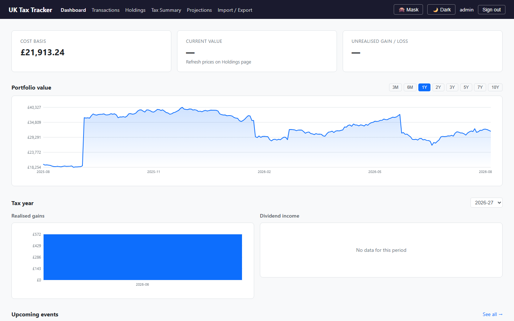
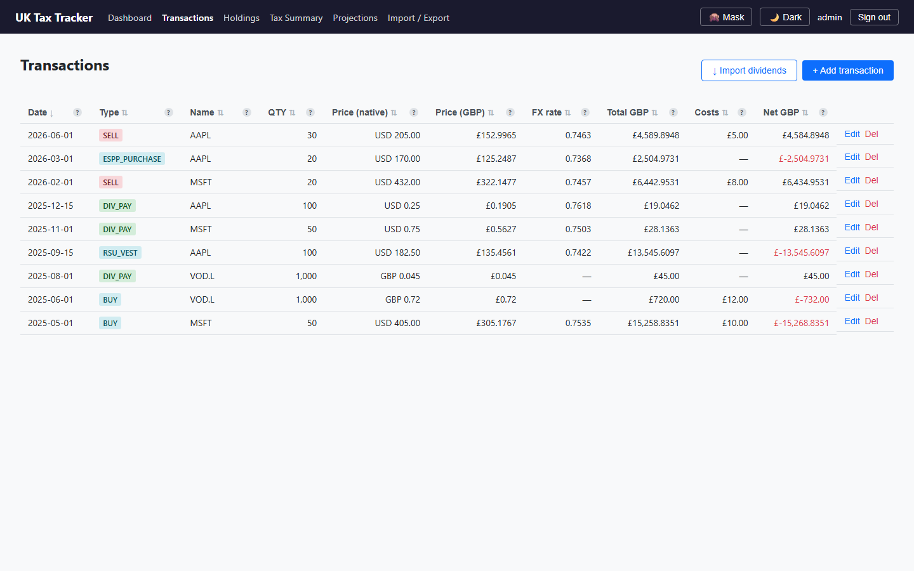
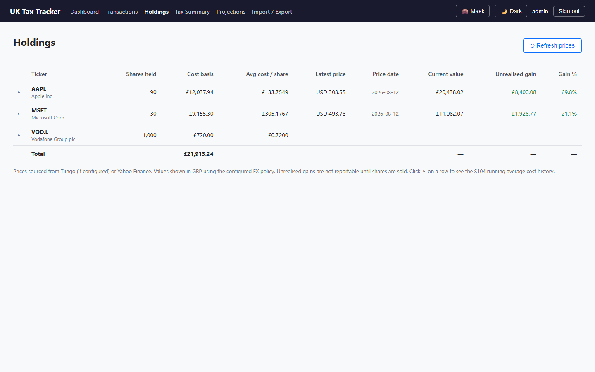
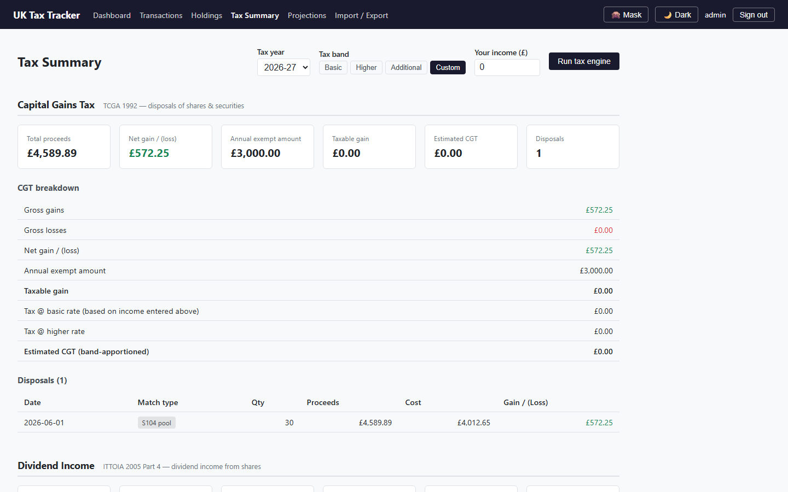
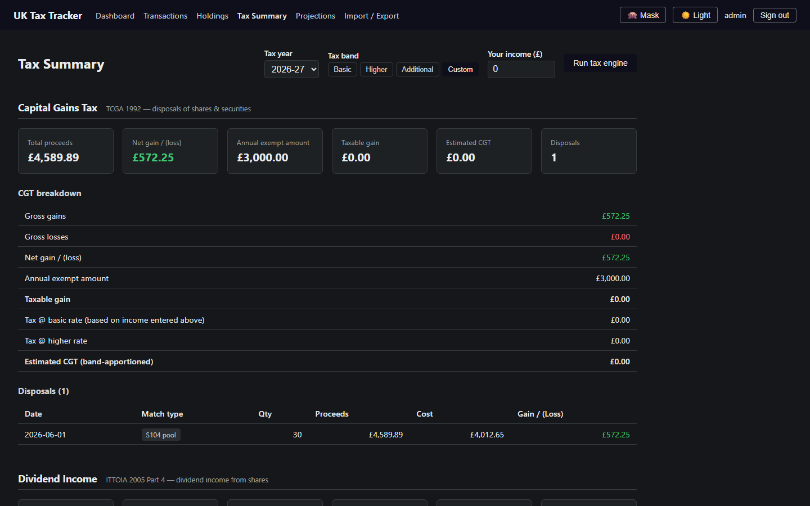
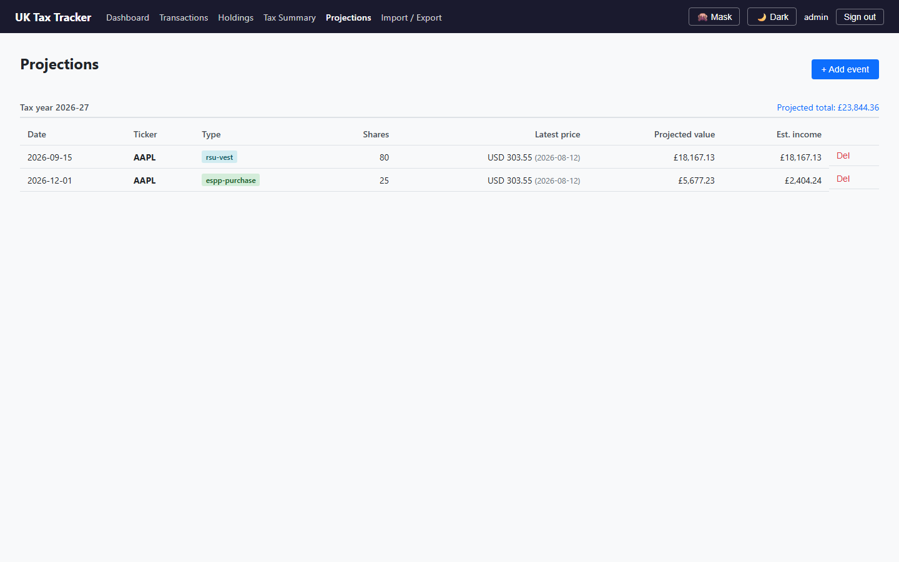
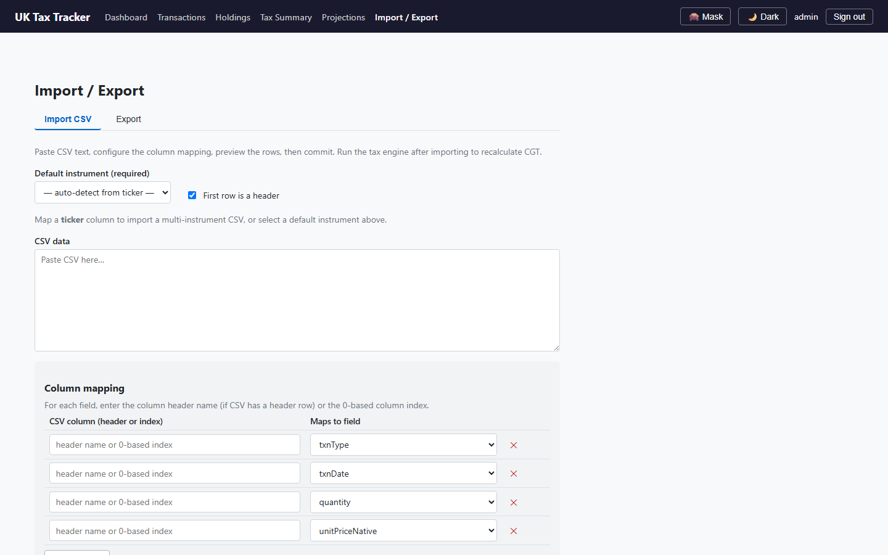
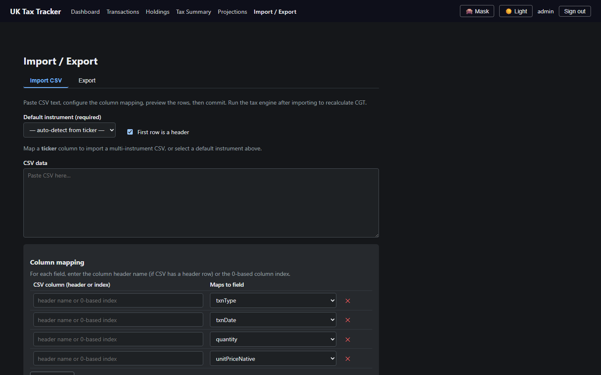

# UK Share Tax Liability Tracker

A self-hosted single-user web app for tracking UK Capital Gains Tax, dividend income, and employment income from RSU/ESPP equity grants. Built on Fastify + Svelte 5 + SQLite — no external database server required. Supports light and dark themes.

> **Not tax advice.** UK Tax Tracker helps you work out your figures from your own records. Check the results against HMRC's guidance, and ask a qualified adviser if you are unsure. It is provided as is, under the [MIT licence](LICENSE).

---

## Quick start

**macOS and Linux**

```sh
curl -fsSL https://github.com/apilbeam101/tax-tracker/releases/latest/download/install.sh | sh
```

**Windows** (PowerShell)

```powershell
& ([scriptblock]::Create((irm https://github.com/apilbeam101/tax-tracker/releases/latest/download/install.ps1)))
```

The installer sets up Node.js if it is missing (it never replaces one you already have), installs the app, and can start it at login. When it finishes, open <http://127.0.0.1:3000> and create your account; [Getting started](docs/GETTING_STARTED.md) walks through first-run setup.

Want to see what these scripts do before you run them? [Desktop install](docs/INSTALL_DESKTOP.md) explains each step and shows how to download, verify and read a script first.

For other ways to run it — Docker, Kubernetes, or as a service on a Linux server — see [Installing UK Tax Tracker](docs/INSTALL.md).

---

## Screenshots

_Populated with dummy data — no real financial information._

| | |
|---|---|
| **Dashboard** |  |
| **Transactions** |  |
| **Holdings** |  |
| **Tax Summary — light** |  |
| **Tax Summary — dark** |  |
| **Projections** |  |
| **Import / Export — light** |  |
| **Import / Export — dark** |  |

---

## Documentation

| | |
|---|---|
| [Getting started](docs/GETTING_STARTED.md) | First-run setup, price and dividend sources, running the tax engine |
| [Adding transactions](docs/adding-transactions.md) | The web UI, the REST API and CSV import |
| [Installing](docs/INSTALL.md) | Which install to choose: [desktop](docs/INSTALL_DESKTOP.md), [Docker](docs/INSTALL_DOCKER.md), [Kubernetes](docs/INSTALL_KUBERNETES.md), [standalone](docs/INSTALL_STANDALONE.md) |
| [Backups, restore and archives](docs/BACKUP_RESTORE.md) | Protecting your data and moving it between installs |
| [Configuration](docs/CONFIGURATION.md) | Every setting, and where it comes from |
| [Security model](docs/SECURITY_MODEL.md) | What is encrypted, unlock modes, what is not protected |
| [Upgrading](docs/UPGRADING.md) | Moving to a new version |
| [Troubleshooting](docs/TROUBLESHOOTING.md) | Starting with `tax-tracker doctor` |
| [Design](DESIGN.md) and [implementation notes](IMPLEMENTATION.md) | How it is built and why |

---

## Security

Sensitive fields are encrypted individually in the database file, under a key that your passphrase protects. The app listens on `127.0.0.1` by default and is meant to run on your own machine or network, behind HTTPS if you reach it from elsewhere. The [security model](docs/SECURITY_MODEL.md) describes what is and is not protected, the unlock modes, and an OWASP Top 10 review. To report a vulnerability, use **Report a vulnerability** on this repository's Security tab rather than a public issue.

---

## Development

Needs Node.js 24 or later.

```sh
git clone https://github.com/apilbeam101/tax-tracker.git
cd tax-tracker
npm install
npm run build          # builds the web client the server serves
```

Start the dev server with hot-reload. It reads its settings from the environment (it does not load a `.env` file), and `AUTO_CONFIG=true` lets it generate its own session secret:

```sh
AUTO_CONFIG=true npm run dev                  # macOS and Linux
$env:AUTO_CONFIG = 'true'; npm run dev        # Windows PowerShell
```

Then open <http://127.0.0.1:3000>. The data goes to the per-user data folder, or to `./data` if that already holds a database ([Configuration](docs/CONFIGURATION.md#data-folder)).

```sh
npm run build          # Svelte client, then the TypeScript server
npm test               # all tests once
npm run test:watch     # Vitest watch mode
npm run lint           # Biome: lint and format check
npm run typecheck      # tsc --noEmit
npx vitest run src/server/services/tax/matching.test.ts   # a single test file
```

`npm start` runs the compiled `tax-tracker` command (`node dist/server/cli.js`); `npm start -- --help` lists its commands.
